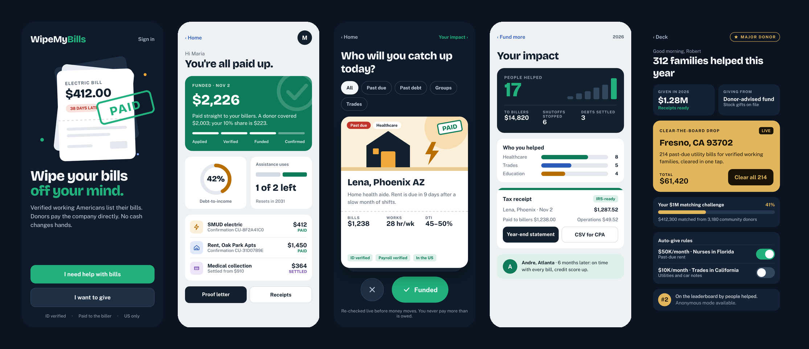
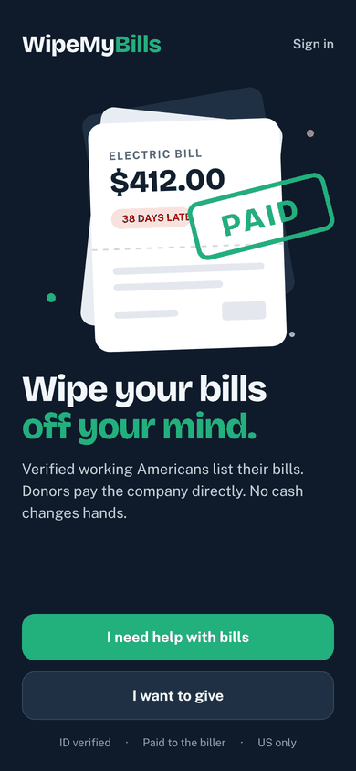
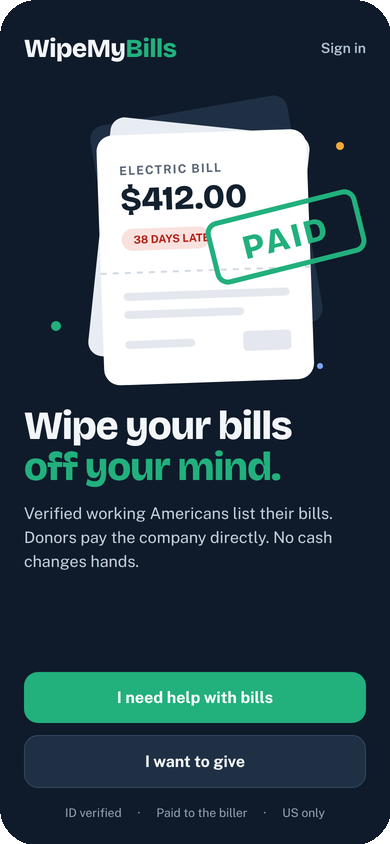
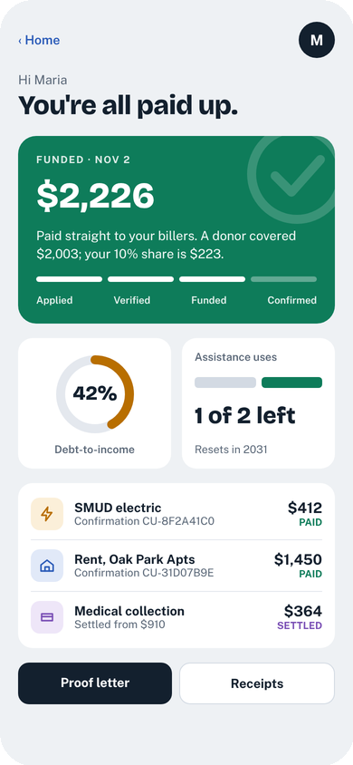
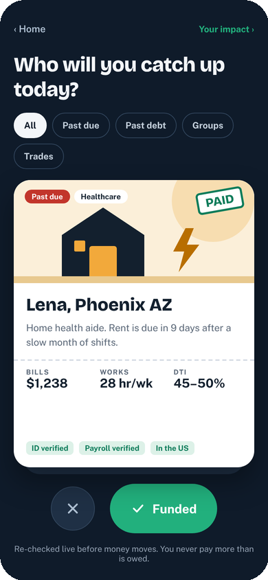
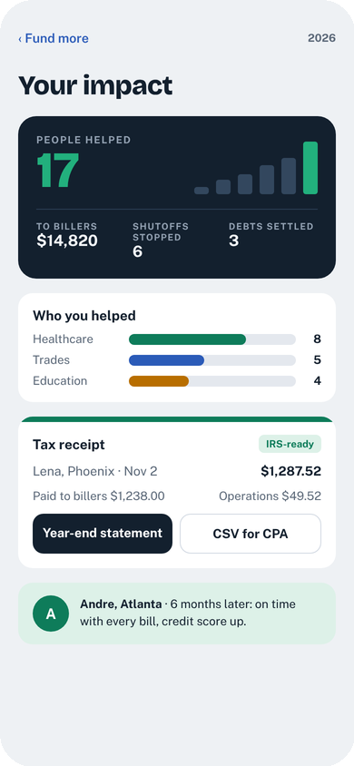
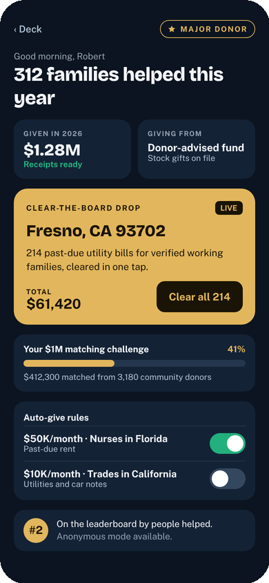
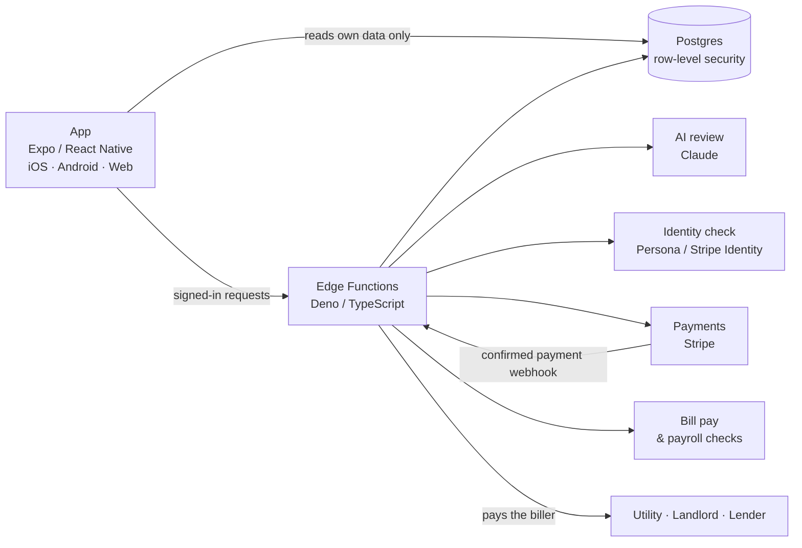

# WipeMyBills

**Verified working Americans list their bills. Donors pay the biller directly. No cash changes hands.**

[Live app: wipemybills.com](https://wipemybills.com) · Built by Ms. Thai · [Novard.ai](https://novard.ai)

| Welcome | Member | Donor: swipe to fund | Donor impact | Major donor |
|---|---|---|---|---|
|  |  |  |  |  |

*Screens shown with sample data. The live app runs in test mode until the nonprofit's payment accounts are approved.*

---

## The problem

Millions of people work full time and still fall behind on rent, utilities and medical bills. Plenty of people want to help, but giving cash to strangers online invites fraud, and donors rarely see where the money went.

## The solution

WipeMyBills is a giving app run by a nonprofit:

1. **Members** (working people, 21+, financially independent) verify who they are, where they work and what they owe, then list their bills.
2. **Donors** browse verified requests, swipe right to add them to a cart, and check out once.
3. **The money goes straight to the biller** (the utility, the landlord, the hospital), never to the member. Donors get a tax receipt and can see exactly whose bills they paid.

## What it does

**For members**
- Step-by-step verification: identity with a selfie match, US location, employment and hours, bills, and a soft credit check that doesn't affect their score
- Past-due bills, upcoming bills, current debt and old debt in collections
- Short bio and optional photo (AI-moderated; personal details removed automatically)
- Live status, thank-you notes to donors, documents and a yearly summary
- One-tap "Delete my account"

**For donors**
- Swipe deck filtered by group (veterans, nurses, teachers, single parents, trades and more), state and urgency
- Cart and wallet: fund several people in one checkout, or chip in part of a larger request
- "Give this amount": type a number and the app builds a list of people it fully pays
- Leaderboards by day, week, month and year; give under a display name or anonymously
- Major-donor tools: bank wire, donor-advised fund and stock gifts; clear-the-board drops by state or group; automatic monthly giving

**For the nonprofit**
- Admin review queue with AI recommendations, plus a log of every decision and the reason behind it
- Reports by date, group and state, as PDF or CSV, including the figures needed for annual nonprofit tax filings
- State-by-state rules for all 50 states, DC and Puerto Rico, switchable from the admin screen

## How it's built

One TypeScript codebase runs on **iPhone, Android, web and desktop**.

| Layer | Tech |
|---|---|
| App | Expo SDK, React Native, React 19, TypeScript, Expo Router |
| Backend | Supabase: Postgres, row-level security, passwordless auth, storage, Edge Functions |
| AI | Claude for request review, document reading, photo and text moderation |
| Payments | Stripe (card, bank, wire), with webhook-confirmed payouts |
| Identity | Persona, with Stripe Identity as backup (US companies only) |
| Hosting | Cloudflare Pages + custom domain, security headers, HTTPS everywhere |
| CI/CD | GitHub Actions: database migrations, function deploys, then live end-to-end tests on every push |

## Security and trust

- **Money never touches the member.** Payments go to the biller, and only after the payment processor confirms the donor's funds.
- **Each person sees only their own data**, enforced inside the database, not just in the app.
- **No passwords.** Sign-in uses email links, and staff actions require two-step verification.
- **Layered fraud checks**: verified ID, one account per person, duplicate-bill detection, sanctions screening for donors, and AI review that hands unclear cases to a person.
- **Privacy by design:** sensitive account numbers are stored only as one-way fingerprints, uploaded documents are deleted automatically, and ID images stay with the identity provider.
- **Built for state law**, including biometric-consent rules in Illinois, Texas and Washington, and charity registration by state.

## Quality

- **50+ automated end-to-end checks** run against the live backend after every deploy: sign-in, eligibility, fraud blocks, payment math to the cent, data privacy between users, admin two-step verification, document checks and account deletion.
- 18 server functions, 13 database migrations, and a typed shared rules module used by both app and server.

## Status

- ✅ Web app live at [wipemybills.com](https://wipemybills.com) (test mode)
- ✅ Full member, donor, major-donor and admin flows working end to end
- ⏳ Nonprofit formation and payment-account approval
- ⏳ App Store and Google Play release

## About

Designed and built by **Ms. Thai**, a payroll and compliance professional with an MS in Applied AI, under [Novard.ai](https://novard.ai).

This repository is a project showcase. The application's source code is private.

© 2026 All rights reserved.
